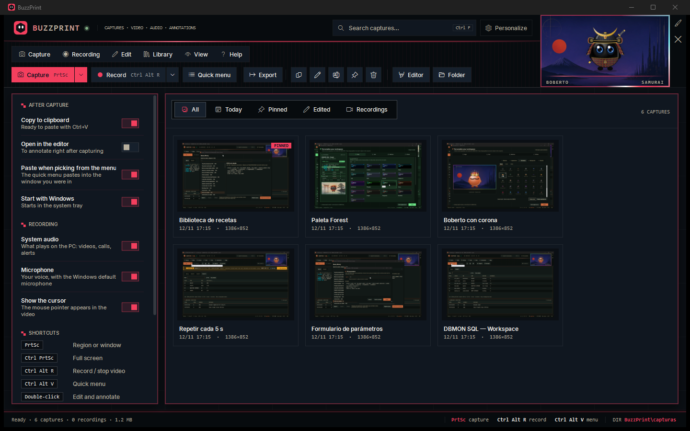
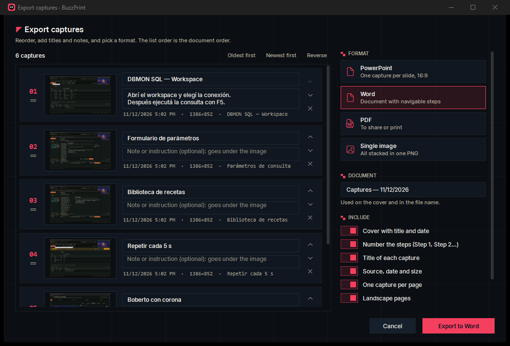
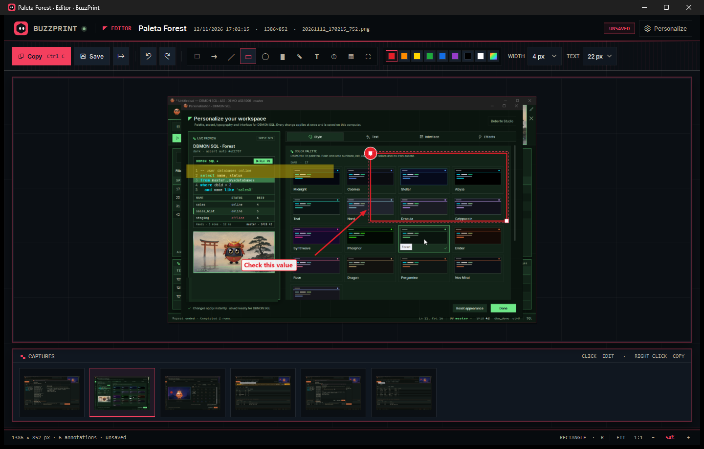

# BuzzPrint

**Screen capture, recording and step-by-step docs for Windows.** Capture a region or window, record video and audio, annotate, pick any capture from a quick menu to paste it anywhere, and export a set of captures, in order, to PowerPoint, Word, PDF or a single image. With Boberto, a live companion you can dress up. English by default, Spanish built in. MIT licensed.



| Export | Editor |
|---|---|
|  |  |

**Requirements:** Windows 10/11, Microsoft Edge WebView2 Runtime (included with Windows 11) and, for recording, FFmpeg. To build: .NET 10 SDK.

## Download (no build needed)

1. Download **`BuzzPrint-<version>-win-x64.zip`** from the [latest release](https://github.com/ChristianBuzzetti/BuzzPrint/releases/latest).
2. Extract it anywhere, for example `C:\Apps`. Avoid running it from inside the zip.
3. Open `BuzzPrint\BuzzPrint.exe`.

Nothing else to install: .NET is included. If FFmpeg (for recording) or WebView2 (for Boberto) is missing, BuzzPrint offers to download it when it's needed.

The app isn't code-signed, so the first time Windows SmartScreen may show *"Windows protected your PC"*: click **More info → Run anyway**.

## Installation from source

Prefer to build it yourself? It takes about five minutes the first time.

**1. Install the tools** (once). Open **PowerShell** and run:

```powershell
winget install Git.Git
winget install Microsoft.DotNet.SDK.10
winget install Gyan.FFmpeg
winget install Microsoft.EdgeWebView2Runtime
```

FFmpeg is only needed to record video and audio; captures, the editor and export work without it. WebView2 is usually already installed (winget says so). **Close PowerShell and open a new one** so it picks up the new tools.

**2. Download BuzzPrint**:

```powershell
cd $HOME
git clone https://github.com/ChristianBuzzetti/BuzzPrint.git
cd BuzzPrint
```

**3. Build it**:

```powershell
powershell -ExecutionPolicy Bypass -File .\build.ps1
```

When it finishes it prints `BuzzPrint publicado en ...\dist\BuzzPrint`. That folder is the complete app: it includes .NET, and FFmpeg is copied to `dist\BuzzPrint\tools` if you installed it.

**4. Run it**:

```powershell
.\dist\BuzzPrint\BuzzPrint.exe
```

BuzzPrint opens the library and stays in the system tray. Press `PrtSc` to capture.

**5. Optional**:
- **Pin it**: right-click BuzzPrint on the taskbar → *Pin to taskbar*.
- **Start with Windows**: turn on *Start with Windows* in the options panel.
- **Move it**: `dist\BuzzPrint` is portable. Copy it anywhere (for example `C:\Apps\BuzzPrint`) and run `BuzzPrint.exe` from there.
- **Spanish**: Personalize → Interface → Language → Español.

**Update** to the latest version: close BuzzPrint (tray icon → Exit), then in the `BuzzPrint` folder:

```powershell
git pull
powershell -ExecutionPolicy Bypass -File .\build.ps1
```

Your captures, recordings and settings are kept: they live outside the app folder (see [Folders](#folders)).

**Troubleshooting**
- *`dotnet` is not recognized*: open a new PowerShell after installing the SDK, or restart Windows.
- *"BuzzPrint está abierto desde …"*: the build stops if BuzzPrint is running. Exit it from the tray icon and build again.
- *Recording says ffmpeg.exe was not found*: install FFmpeg (step 1), open a new PowerShell and build again.
- *`PrtSc` opens the Snipping Tool*: BuzzPrint uses `Ctrl+Shift+X` instead and tells you so; or turn off *Use the Print Screen key to open screen capture* in Windows Settings → Accessibility → Keyboard.

## Shortcuts

| Shortcut | Action |
|---|---|
| `PrtSc` (if Windows has taken it: `Ctrl+Shift+X`) | All-in-one capture: drag a region **or** click the highlighted window. `Enter` = window, `F` = full screen, `Esc` or right-click = cancel |
| `Ctrl+PrtSc` | Full screen |
| `Ctrl+Alt+R` | **Record video**: pick a region, window or the screen (`F`), 3-2-1 countdown and it records. The same shortcut stops it |
| `Ctrl+Alt+V` | **Quick menu** next to the cursor: `1`–`9` or click = copy **and paste** where you were; `Shift` = copy only; `E` or right-click = edit |
| `Ctrl+E` | Export the selected captures |
| `Ctrl+Shift+C` | Copy the selected captures as one image |

## Features

- **Recording**: MP4 video (H.264) with system audio and/or microphone, or **audio only** (MP3). A floating bar shows the time and level, with Stop and Discard. The bar and the area frame never show up in the video. Recordings live in the **Recordings** tab: double-click plays them, `Ctrl+C` copies them as files, and you can drag them into other apps.
- **Library**: All / Today / Pinned / Edited / Recordings tabs, search (`Ctrl+F`), double-click to edit, `Ctrl+C`, `F2` to rename, `Ctrl+P` to pin, `Del`, drag into other apps. New captures are named by kind and time, e.g. `Region_12_11_2026_16_05_33` (window captures use the window title).
- **Filters and sections**: filter by **day** (today, yesterday, last 7 days, this month or any specific day), by **section**, and **group** the library by day, section or source, with collapsible headers. Sections are your own groups (a project, a client, a topic): **New section**, right-click → **Move to section**, and Library → rename or delete a section (its captures stay in the library).
- **Export** (`Ctrl+E`, the Export button or right-click): the selected captures, in order, to **PowerPoint** (one per slide, 16:9), **Word** (steps as navigable headings, page numbers in the footer), **PDF** or **one image**. Reorder by dragging, with `Alt+↑/↓` or by date; each capture gets a title and a note shown under the image (both saved back to the library). Options: cover, step numbers, source and date, one per page, landscape. If you picked captures one by one with `Ctrl+click`, that order is kept; otherwise they go in chronological order. Library → **Export today's…** builds the day's document in one step.
- **Copy as one image** (`Ctrl+Shift+C`): stacks the selected captures, numbered and titled, into one image ready to paste into a chat or an email.
- **Editor**: select, arrow, line, rectangle, ellipse, highlighter, pen, text, numbered steps, pixelate and crop (`V A L R E H P T N B C`), colors, stroke width, undo and redo, `Ctrl+wheel` zoom and a capture tray. Saving an edit **keeps the original**: the annotated version is saved as a new capture `<name>_edited` (turn this off in the options panel → *Keep the original when editing*). Annotations stay editable.
- **Components**: .NET is inside the app. If FFmpeg is missing, BuzzPrint offers to download it the first time you record (official gyan.dev build, SHA-256 checked, kept in `%LOCALAPPDATA%\BuzzPrint\tools`). If WebView2 is missing, it offers Microsoft's installer (signature checked). Help → **Check components…** does both on demand.
- **Personalize** (header or View menu): palette (23 palettes, 17 dark and 6 light, with an independent accent), fonts, corners, density, options panel, language, Boberto and animations. Clicking Boberto opens Boberto Studio.
- **Logo** (Personalize → Effects → Logo): head shape (hexagon, circle, rounded, diamond, ghost), eyes (oval, round, happy, lines, pixel), head color and background (or your palette's accent). It restyles the header logo and the window and tray icons; the `.exe` icon stays the original. The logo is alive: its eyes follow the cursor, it blinks, and clicking it blinks both eyes, alternates them or double-blinks. It stays still with animations off.
- **Boberto**: ships with a black body, blue eyes, samurai helmet, Mirai night background and crossed frame (change it all in Studio). With an empty library he appears in the middle, watches the cursor and plays gestures; click for another one.
- **Language**: English by default, Spanish available (Personalize → Interface → Language, or View → Language). The app restarts to apply it.
- **System tray**: click = quick menu (or stop, while recording), double-click = library, right-click = menu.

## Folders

Choose them in the options panel → Storage → **Change…** (it offers to move what you already have).

- Captures: `Pictures\BuzzPrint\capturas` by default.
- Recordings: `Videos\BuzzPrint` by default.
- Settings and Boberto profile: `%LOCALAPPDATA%\BuzzPrint`.

## Build details

```powershell
.\build.ps1          # self-contained publish to dist\BuzzPrint (bundles .NET 10 and copies ffmpeg to tools)
.\build.ps1 -Shot    # also saves verification screenshots to artifacts\shots (includes a real test recording)
.\build.ps1 -Zip     # also builds artifacts\BuzzPrint-<version>-win-x64.zip for GitHub Releases
.\build.ps1 -Msix    # also builds artifacts\store\BuzzPrint_<version>.0_x64.msix for the Microsoft Store
.\build.ps1 -Msix -TestSign   # plus a ..._test.msix signed with a self-signed certificate, to install on this PC
```

Needs the **.NET 10 SDK** (`dotnet` on the PATH, or its path in `$env:BUZZPRINT_DOTNET`). The publish is self-contained: users don't need to install .NET. Recording uses **FFmpeg** (`winget install Gyan.FFmpeg`); `build.ps1` copies it to `dist\BuzzPrint\tools`. Audio is captured with WASAPI (system loopback and the default microphone).

`BuzzPrint.exe --icon DIR` redraws the icon (Boberto's hexagon head and eyes, as vectors, crisp from 16 to 256 px) plus a preview sheet. The appearance system (`src\BuzzPrint\Appearance`) and the Boberto engine (`src\BuzzPrint\Assets\Boberto`) come from the author's DBMON SQL project.

### Microsoft Store package

`-Msix` compiles the **Store flavor** (`-p:Store=true`, symbol `STORE`): start with Windows uses the package's startup task instead of the `Run` registry key, and nothing is downloaded at run time (FFmpeg *essentials* from gyan.dev is bundled in `tools\`, SHA-256 checked at build time; for a missing WebView2 the app links to Microsoft's page). The Windows SDK tools (`makeappx`, `makepri`, `signtool`) come from the `Microsoft.Windows.SDK.BuildTools` NuGet package, cached in `artifacts\cache`.

The package identity is in `packaging\store.json`. Before uploading, replace its three values with the ones in Partner Center → BuzzPrint → Product identity. Upload the unsigned `.msix`; the Store signs it. To try the test package, trust its certificate once (PowerShell as administrator) and double-click the `_test.msix`:

```powershell
Import-Certificate -FilePath artifacts\store\BuzzPrint-test.cer -CertStoreLocation Cert:\LocalMachine\TrustedPeople
```

The Store version keeps its settings in the package's own data folder, separate from the zip version.

## License

[MIT](LICENSE) © Christian Buzzetti. The bundled fonts (Inter, JetBrains Mono) keep their SIL Open Font License; see [THIRD-PARTY-NOTICES.md](THIRD-PARTY-NOTICES.md).
