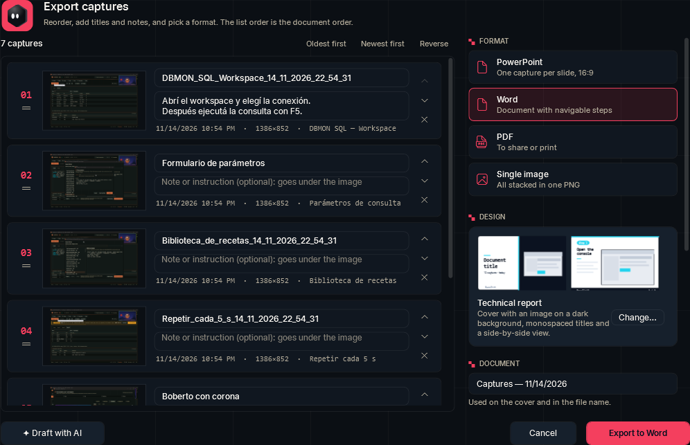

# BuzzPrint

**Screen capture, recording and step-by-step docs for Windows.** Capture a region or window, record video and audio, annotate, pick any capture from a quick menu to paste it anywhere, and export a set of captures, in order, to PowerPoint, Word, PDF or a single image with professional templates. Optional **AI** (off until you turn it on) adds titles, summaries, step-by-step guides, incident reports and data redaction with the AI service you choose. With Boberto, a live companion you can dress up, and a built-in guide (`F1`). English by default, Spanish built in. MIT licensed.

BuzzPrint 0.6 and later are built in Rust. Previous .NET releases are archived under their original tags. [Last .NET release (v0.5.0)](https://github.com/ChristianBuzzetti/BuzzPrint/releases/tag/v0.5.0).


| Export | Editor |
|---|---|
|  |  |

**Requirements:** Windows 10 version 1809 or later, or Windows 11 (x64). Recording uses FFmpeg. Boberto Studio uses the Microsoft Edge WebView2 Runtime.

## Download (no build needed)

### Microsoft Store (recommended)

<a href="https://apps.microsoft.com/detail/9PP5NT1T6VQF"></a>

The Store version updates automatically and includes FFmpeg for recording. AI stays off until you set it up. [Get BuzzPrint from the Microsoft Store](https://apps.microsoft.com/detail/9PP5NT1T6VQF).

### Zip from GitHub

1. Download `BuzzPrint-rs-0.6.0-win-x64.zip` from the [latest release](https://github.com/ChristianBuzzetti/BuzzPrint/releases/latest) or [download the 0.6.0 zip directly](https://github.com/ChristianBuzzetti/BuzzPrint/releases/download/v0.6.0/BuzzPrint-rs-0.6.0-win-x64.zip).
2. Extract the zip and open `BuzzPrint\buzzprint.exe`. Keep the `boberto` folder next to the executable.
3. To record video or audio, use an existing FFmpeg installation or accept the download offered by BuzzPrint. Install the WebView2 Runtime if you want to use Boberto Studio and Windows doesn't already have it.

Windows SmartScreen may show a prompt when you first open the unsigned zip build.

## Installation from source

Install Git, [Rust with rustup](https://rustup.rs/) using the x64 MSVC toolchain, and [Visual Studio Build Tools](https://visualstudio.microsoft.com/visual-cpp-build-tools/) with the **Desktop development with C++** workload and a Windows SDK. Open a new PowerShell after installation.

```powershell
git clone https://github.com/ChristianBuzzetti/BuzzPrint.git
cd BuzzPrint
cargo build --release --locked
.\target\release\buzzprint.exe
```

BuzzPrint opens the library and adds a tray icon. Press `PrtSc` to capture. Pass `--tray` to launch in the tray.

Close BuzzPrint from the tray before rebuilding. Use `cargo test --locked` for the test suite or run the export self-test with a folder of your choice.

```powershell
.\target\release\buzzprint.exe --selftest "$env:TEMP\buzzprint-selftest"
```

If Windows assigns `PrtSc` to Snipping Tool, BuzzPrint offers `Ctrl+Shift+X` as a fallback. You can also change the Print Screen assignment in Windows Settings → Accessibility → Keyboard.

## Shortcuts

| Shortcut | Action |
|---|---|
| `PrtSc` (if Windows has taken it: `Ctrl+Shift+X`) | All-in-one capture: drag a region **or** click the highlighted window. `Enter` = window, `F` = full screen, `Esc` or right-click = cancel |
| `Ctrl+PrtSc` | Full screen |
| `Ctrl+Alt+R` | **Record video**: pick a region, window or the screen (`F`), 3-2-1 countdown and it records. The same shortcut stops it |
| `Ctrl+Alt+V` | **Quick menu** next to the cursor: `1`–`9` or click = copy **and paste** where you were; `Shift` = copy only; `E` or right-click = edit |
| `Ctrl+E` | Export the selected captures |
| `Ctrl+Shift+C` | Copy the selected captures as one image |

## Features

- **Guide** (`F1`, Help → BuzzPrint guide, or the sidebar): every feature explained step by step, with search, shortcuts and buttons that open each feature. It's offered once on the first start.
- **Document templates** include six built-in designs each for PowerPoint, Word, and PDF/image. Export shows a page preview with your captures. Create a template with your own colors, fonts, cover, footer and logo.
- **Recording**: MP4 video (H.264) with system audio and/or microphone, or **audio only** (MP3). A floating bar shows the time and level, with Stop and Discard. The bar and the area frame never show up in the video. Recordings live in the **Recordings** tab: double-click plays them, `Ctrl+C` copies them as files, and you can drag them into other apps.
- **Library**: All / Today / Pinned / Edited / Recordings tabs, search (`Ctrl+F`), double-click to edit, `Ctrl+C`, `F2` to rename, `Ctrl+P` to pin, `Del` (to the Recycle Bin), drag into other apps. Search also finds the **text inside captures**, read on your PC with Windows' own recognition. Cards widen to fill each row. New captures are named by kind and time, e.g. `Region_12_11_2026_16_05_33` (window captures use the window title).
- **Filters and sections**: filter by **day** (today, yesterday, last 7 days, this month or any specific day), by **section**, and **group** the library by day, section or source, with collapsible headers. Sections are your own groups (a project, a client, a topic): **New section**, right-click → **Move to section**, and Library → rename or delete a section (its captures stay in the library).
- **Export** (`Ctrl+E`, the Export button or right-click): the selected captures, in order, to **PowerPoint** (one per slide, 16:9), **Word** (steps as navigable headings, page numbers in the footer), **PDF** or **one image**. Reorder by dragging, with `Alt+↑/↓` or by date; each capture gets a title and a note shown under the image (both saved back to the library). Options: cover, step numbers, source and date, one per page, landscape. If you picked captures one by one with `Ctrl+click`, that order is kept; otherwise they go in chronological order. Library → **Export today's…** builds the day's document in one step.
- **Copy as one image** (`Ctrl+Shift+C`): stacks the selected captures, numbered and titled, into one image ready to paste into a chat or an email.
- **Editor**: select, arrow, line, rectangle, ellipse, highlighter, pen, text, numbered steps, pixelate and crop (`V A L R E H P T N B C`), colors, stroke width, undo and redo, `Ctrl+wheel` zoom and a capture tray. Saving an edit **keeps the original**: the annotated version is saved as a new capture `<name>_edited` (turn this off in the options panel → *Keep the original when editing*). Annotations stay editable.
- **Components** appear under Help → **Check components…**. The Store package bundles FFmpeg. The zip can use an installed copy or download the gyan.dev build after checking its SHA-256. WebView2 is used for Boberto Studio.
- **Personalize** (sidebar or View menu): palette (23 palettes, 17 dark and 6 light, with an independent accent), fonts, rounded or square panels and controls (separately), language, Boberto and animations. Clicking Boberto opens Boberto Studio.
- **Logo** (Personalize → Logo) offers 14 head shapes, six eye styles, and custom colors. The eyes follow the cursor, and clicking the logo makes it blink. You can turn off animations.
- **Boberto**: ships with a black body, blue eyes, samurai helmet, Mirai night background and crossed frame (change it all in Studio). With an empty library he appears in the middle, watches the cursor and plays gestures; click for another one.
- **AI** (optional and off by default) connects to Claude, Gemini, ChatGPT, OpenRouter, a local Ollama or another OpenAI-compatible service. Generate titles, summaries, guides and incident reports, ask about a capture, find sensitive data to redact, or organize the library. BuzzPrint shows the destination and what it will send before each request. Automatic captions send new captures if you enable them. You can report inappropriate generated content from the result views.
- **Language**: English by default, Spanish available (Personalize → Interface → Language, or View → Language). The app restarts to apply it.
- **System tray**: click = quick menu (or stop, while recording), double-click = library, right-click = menu.

## Folders

Choose them in the options panel → Storage → **Change…** (it offers to move what you already have).

- Captures: `Pictures\BuzzPrint\capturas` by default.
- Recordings: `Videos\BuzzPrint` by default.
- Settings and Boberto profile: `%LOCALAPPDATA%\BuzzPrint`.

## Build details

```powershell
.\build.ps1                  # builds target\release\buzzprint.exe
.\build.ps1 -Zip             # builds artifacts\BuzzPrint-rs-<version>-win-x64.zip
.\build.ps1 -Msix            # builds artifacts\store\BuzzPrint_<version>.0_x64.msix
.\build.ps1 -Msix -TestSign  # also builds a signed ..._test.msix and a test certificate
```

### Microsoft Store package

`-Msix` bundles the gyan.dev FFmpeg essentials build after checking its SHA-256. It fetches `makeappx`, `makepri` and `signtool` from the Microsoft Windows SDK BuildTools NuGet package and caches them in `artifacts\cache`. **Start with Windows** uses the package's `BuzzPrintStartup` task. The zip build uses the current user's `Run` registry key.

The package identity is in `packaging\store.json`. Partner Center takes the unsigned `.msix` and the Store signs it. To install the local test build, trust its certificate from an elevated PowerShell, then open the `_test.msix` file.

```powershell
Import-Certificate -FilePath artifacts\store\BuzzPrint-test.cer -CertStoreLocation Cert:\LocalMachine\TrustedPeople
```

## License

[MIT](LICENSE) © Christian Buzzetti. The bundled fonts (Inter, JetBrains Mono) keep their SIL Open Font License; see [THIRD-PARTY-NOTICES.md](THIRD-PARTY-NOTICES.md).
